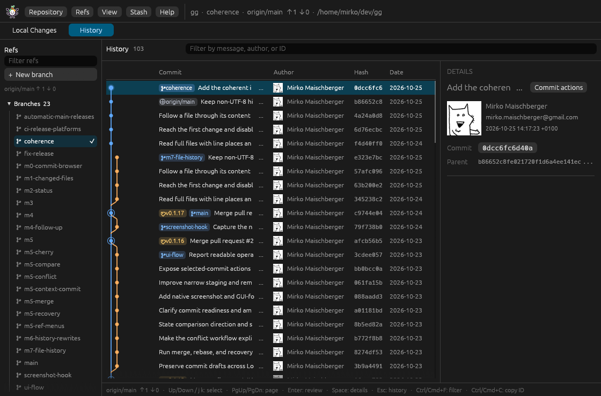

# gg · good git



Purpose: introduce gg and explain installation and use.

A native, fast-starting Git GUI and CLI. Browse history, inspect diffs, stage files, commit, and recover rewrites from a focused desktop interface, with the same operations available on the command line.

## Why gg

- **Fast, native desktop app.** Opens directly into a repository with a focused history, refs, and details layout.
- **Easy staging and commit flow.** Local Changes shows staged, unstaged, untracked, and conflicted paths with clear whole-file, hunk, and line actions.
- **Responsive operations.** Merge, rebase, rewrite, conflict reads, and status scans run on background workers so navigation stays smooth.
- **Visible recovery.** Private backup refs, conflict recovery, and explicit discard/reset confirmations keep destructive actions deliberate.

Download binary archives from [GitHub Releases](https://github.com/baol/gg/releases) when available, or from the Rust workflow artifacts. Builds cover Linux, macOS, and Windows on x86_64 and arm64. Verify the SHA-256 sidecar, extract the archive, and place `git-good` (`git-good.exe` on Windows) on your PATH. See [platform requirements and release gates](docs/development.md).

Build from source:

```sh
cargo install --path apps/git-good --locked
cd /path/to/repository
git good
git good history
git good refs
git good switch feature-x
git good switch --create feature-y
git good status
git good status --file src/main.rs --area unstaged
git good stage --file src/main.rs
git good stage --file src/main.rs --hunk '@@ -10,3 +10,4 @@'
git good show HEAD
git good show HEAD --file src/main.rs
git good show HEAD --file assets/logo.png --export after --output /tmp/logo.png
git good fetch [REMOTE] [--prune] [--repo PATH]
git good push [REMOTE] [BRANCH] [--set-upstream] [--repo PATH]
git good clone URL [PATH]
git good stash list
git good stash push -m MESSAGE [--include-untracked] [--keep-index]
git good stash apply|pop [STASH] [--index]
git good stash drop [STASH]
git good cherry-pick COMMIT
git good revert COMMIT
git good cherry-pick|revert --continue|--abort|--skip
git good merge REF [--no-ff]
git good merge --continue|--abort
git good rebase REF [--autostash]
git good rebase --continue|--skip|--abort
git good rewrite --from COMMIT [--autostash] --pick COMMIT... [--squash COMMIT]...
git good rewrite --continue|--skip|--abort
git good conflicts
git good conflict --file PATH [--use ours|theirs|--stage]
git good commit --amend -m MESSAGE
git good reflog [REF]
git good reset --soft|--mixed|--hard COMMIT
git good branch --delete BRANCH [--force]
git good branch --create NAME [--at REF]
git good tag --delete TAG
```

`git good` (or `git-good`) opens the containing repository, including from nested directories. Supply a path to open another repository.

Stream, filter, and inspect history; copy commit IDs. The graph includes commits reachable from HEAD and every local branch, remote branch, and tag. The history view draws commit lanes and branch, remote, and tag pills before the subject. Click a pill to select its commit; double-click a branch pill to switch to that branch, or a tag/remote pill to jump to its commit. At wide widths a refs sidebar groups branches, remotes, and tags with filtering and a HEAD check; the **Refs** menu remains the narrow-window fallback. Both mark the current branch, switch local branches after a clean-worktree check, create a new branch from HEAD, and jump to tags or remotes. Read-only ref, remote, and tracking labels are also available as `git good refs [PATH]` JSON. Select a commit and press **Enter** to browse its changed files; **Back to history** restores your position. `git good show HEAD [--repo PATH] [--parent N]` streams the same file summaries as JSON. For merges, choose a parent in Review. Binary files show PNG/JPEG previews or a hexadecimal sample. Use **Export before/after** to save complete content to a new file. Select a file to read its diff; **Enter** opens a full-width reading view and **Escape** returns to files. Add `--file PATH` to output that diff as JSON. Parents are one-based; the default is the first parent, or the empty tree for a root commit.

Tracking and network actions stay explicit. The refs sidebar and status line show the current branch's upstream and ahead/behind counts; choose **Track remote branch…** from **Refs** to create a local tracking branch after a clean-worktree check. The **Repository** menu offers **Fetch**, **Push**, and **Clone…**. Fetch updates remote-tracking refs only; Push sends the current branch without force and records upstream when it is absent; Clone opens the new repository only after Git succeeds. Operations run one at a time, stream bounded progress in the status line, and can be cancelled. Authentication and transport use your Git configuration, credential helpers, and SSH agent; failures are actionable and never print credentials. CLI receipts are JSON on stdout and progress goes to stderr.

Use **Stash** to park work without committing. **Stash changes…** records a message and can include untracked files or keep staged content in the index; **Manage stashes…** lists entries with Apply, Pop, and a confirmed Drop. Conflicting applies keep the entry, list the unmerged paths in the status line, and leave the conflict markers for recovery. The CLI exposes the same operations with JSON receipts: `git good stash list`, `git good stash push`, `git good stash apply`, `git good stash pop`, and `git good stash drop`.

Cherry-pick or revert the selected history commit from its right-click menu. A conflicting operation leaves an in-progress banner with **Continue**, **Skip**, and **Abort**; the status line names the operation and conflict count. The CLI mirrors the same flow with `git good cherry-pick COMMIT`, `git good revert COMMIT`, and their `--continue`, `--skip`, and `--abort` recovery forms.

Use **Refs → Merge branch…** to merge a local branch, remote-tracking ref, or tag. Fast-forward and already-up-to-date merges complete directly; diverged histories create a merge commit, and **Always create a merge commit** forces one. A conflicting merge leaves the in-progress banner with **Continue** and **Abort** (Skip is hidden because Git does not support it), and the status line reports the conflict count. CLI: `git good merge REF [--no-ff]` and `git good merge --continue|--abort`.

Use **Refs → Rebase branch…**, or a branch, remote, or tag context menu, to rebase the current branch onto that reference. The dialog requires a clean tracked worktree unless **Automatically stash working changes** is selected, confirms the rewrite, and states that a private `refs/gg/backup/...` ref is created before Git starts. A conflicting rebase uses the same recovery banner with **Continue**, **Skip**, and **Abort**; completion or abort refreshes history, refs, status, an open reflog, and open backups, and restores the pre-rewrite history row. CLI: `git good rebase REF [--autostash]` and `git good rebase --continue|--skip|--abort`.

Select a history commit and choose **Reorder and squash to HEAD…** from its context menu to rewrite that commit through HEAD. The dialog lists the linear range oldest first with Up/Down controls and a **Squash** choice that combines a commit into the row above; merge commits are rejected rather than flattened. Every selected commit must remain in the plan, and the first row always stays a pick. Reordering starts Git's interactive rebase with a generated todo, so conflicts, hooks, and recovery match Git. The tracked worktree must be clean unless **Automatically stash working changes** is selected, and a private `refs/gg/backup/rewrite/...` ref is created before Git starts. The dialog stays open with a **Rewriting commits…** or **Refreshing history…** progress state and closes only after the refreshed commit list is ready. Conflicts use the recovery banner; completion, skip, or abort restores the pre-rewrite selection. CLI: `git good rewrite --from COMMIT [--autostash] --pick COMMIT... [--squash COMMIT]...` and `git good rewrite --continue|--skip|--abort`.

While an operation is in progress, choose **Resolve conflicts…** to see each unmerged path with Base, Ours, and Theirs content. Select a side, stage manually resolved content, then Continue or Abort from the banner. Recovery refreshes history, refs, status, an open reflog, and open backups, and preserves an open Local Changes view. CLI: `git good conflicts`, `git good conflict --file PATH`, `git good conflict --file PATH --use ours|theirs`, and `git good conflict --file PATH --stage`.

Right-click a history row for **Cherry-pick**, **Revert**, **Reset here** (Soft, Mixed, or Hard), **Reorder and squash to HEAD…**, **Compare with current HEAD**, **Copy hash**, and **Copy subject**. Reset here confirms first; Hard warns that staged and working changes are discarded. Compare with current HEAD opens the selected commit against the current branch tip and names the resolved Before and After sources, including the `HEAD` ref name. The reorder action is disabled while another operation is in progress. CLI: `git good reset --soft|--mixed|--hard COMMIT` and `git good show <commit> --against REF`.

Right-click a ref in the sidebar for its actions. Branches offer switch, merge into the current branch, rebase the current branch onto it, delete (safe first, then a confirmed force delete), and copy name/hash. Tags offer jump, merge, rebase, delete, and copy. Remotes offer tracking-branch creation, merge, rebase, and copy. CLI: `git good branch --delete BRANCH [--force]`, `git good branch --create NAME [--at REF]`, and `git good tag --delete TAG`.

Rewrite the latest commit with the **Amend** toggle in the Local Changes commit bar. Amend mode compares the index with HEAD's parent, so the staged list shows the commit's actual contents; stage working files, hunks, or lines to add them, or unstage to remove them from the amended commit without changing your working files. An amend banner names the affected commit and subject, and the message editor expands and collapses. A normal commit enables only after the status scan completes with a nonempty message and staged files; message-only amend stays valid, and disabled states explain why. The original author is preserved, Git hooks run in order (including `post-rewrite`), and the previous tip is saved under a private `refs/gg/backup/...` ref that stays out of the refs sidebar. CLI: `git good commit --amend -m MESSAGE`.

Use **Repository → Reflog…** to inspect `HEAD` or a local branch newest-first. Each entry shows its selector, commit, time, action, and detail. **Reset branch here** offers Soft, Mixed, and Hard with confirmation and the Hard warning; **Create branch here…** recovers a tip without switching; **Copy hash** writes the exact ID. Listing is read-only. CLI: `git good reflog [REF]`.

Use **Repository → Backups…**, or the **Backups…** button in the in-progress banner, to inspect private refs saved before amend, rebase, reorder, or squash. Each backup shows its kind, commit subject, full private ref, and commit time. **Open commit** reviews the saved tip, **Reset branch here** offers Soft, Mixed, and Hard with the existing confirmation and Hard warning, **Create branch here…** recovers it without switching, and **Copy hash**/**Copy ref** write exact identifiers. Backups never appear in the refs sidebar, and recovery does not delete backup refs or user files.

Choose **Local Changes** in the navigation sidebar, or in the toolbar at narrow widths, to inspect staged, unstaged, untracked, and conflicted paths. The toolbar, sidebar, and refs stay visible while Local Changes is open. **Refresh** rescans the worktree; **All Commits** restores history. `git good status [PATH]` streams the same entries as JSON.

Open a row with **View diff** or Enter to review both sides of the path together. The **Staged** pane compares HEAD with the index, or HEAD's parent with the index while **Amend** is on; the **Unstaged** pane compares the index with the working file. They sit side by side at wide widths. Narrow windows show a **Staged**/**Unstaged** switch with counts, focus the nonempty pane by default, and offer **Split** to stack both comparisons. Each pane offers **Stage file** or **Unstage file**, and the unstaged pane also offers **Discard file**. Use the inline **Stage hunk**/**Unstage hunk** action to apply a whole hunk, click a hunk header to select all of its changed lines, or click individual added/deleted lines to select only those lines. **Discard hunk** or **Discard selected** discards working changes after confirmation, leaving the index untouched. Successful actions refresh both panes in place, and **Back to files** returns to a refreshed status list. The Local Changes view includes a commit message field; **Commit** writes the index and runs the repository's Git hooks, while **Amend** rewrites HEAD with the staged index and message. Hook failures abort before HEAD changes and refresh the status so recovery is visible. Add `--file PATH --area staged|unstaged|untracked` for a selected-file comparison.

[Contributing](CONTRIBUTING.md) · [Development](docs/development.md) · [Architecture](docs/architecture.md) · [Design](docs/design.md) · [Plan](docs/plan.md) · [Roadmap](ROADMAP.md) · [Regression coverage](docs/regression.md) · [Verification](docs/verification.md)

Apache-2.0 · [LICENSE](LICENSE)

In Status, **Stage file** records the selected working path in the index at action time; **Unstage file** restores a staged row from HEAD. Both preserve working edits and unrelated staging. Inside **Review & stage**, the inline hunk and line actions stage or unstage only the selected changes; whole-file actions remain available for modes, type changes, symlinks, untracked additions, and deletions. **Drop** discards working changes only: tracked content is restored from the index, untracked files are removed, and the index is never modified. CLI: `git good stage --file PATH [--hunk HEADER]... [--repo PATH]`, `git good unstage --file PATH [--repo PATH]`, `git good commit -m MESSAGE [--repo PATH]`, `git good commit --amend -m MESSAGE [--repo PATH]`, `git good reflog [REF] [--repo PATH]`, `git good branch --create NAME [--at REF] [--repo PATH]`, and `git good switch [--create] BRANCH [--repo PATH]`. Commit runs `pre-commit`, `prepare-commit-msg`, `commit-msg`, and `post-commit` hooks; a pre-commit or message-hook failure leaves the index and working tree intact and keeps the message for retry. A failing post-commit hook reports a warning after the commit exists. Repeat `--hunk` with exact `@@` headers from `git good status --file PATH --area unstaged` to stage multiple hunks.

Use **Repository** for Open, Refresh, Reflog, Backups, Fetch, Push, and Clone, **Stash** for stash actions, **Refs** for branch actions, merge, and rebase, the **Actions** menu or Alt+A for the selected commit, commit-row menus for the same commit commands, and **View** or Space for commit details. **Help** lists the keyboard shortcuts. Arrows and j/k navigate lists; in reading views they scroll content. Page keys move a viewport; Enter/Right opens the selection and Escape/Left returns. Text editors retain their keys.
