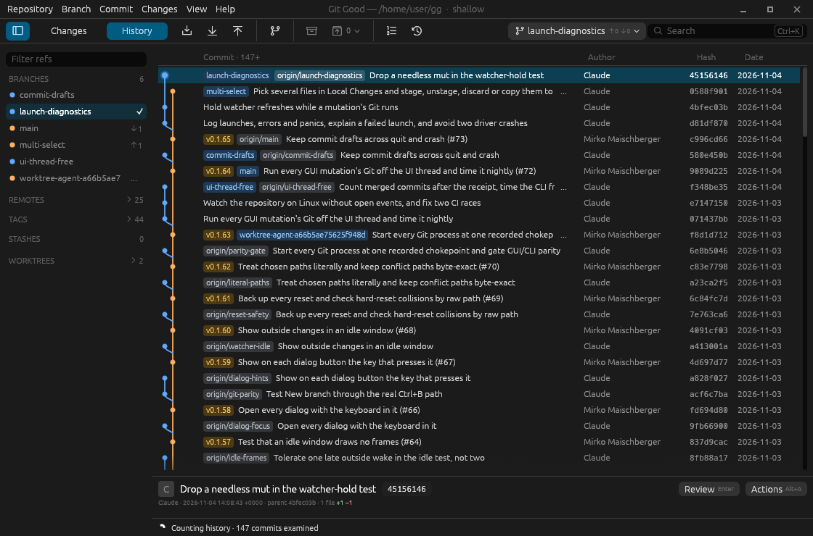

# Git Good

Purpose: introduce Git Good and explain installation and use.

**A fast, native Git desktop app that runs your own `git`, and can undo any rewrite.**

Linux, macOS and Windows, on x86_64 and Arm. Free and open source (Apache-2.0).

```sh
curl -fsSL https://raw.githubusercontent.com/baol/gg/main/scripts/install.sh | sh
```

```powershell
irm https://raw.githubusercontent.com/baol/gg/main/scripts/install.ps1 | iex
```

Then run `git good` in any repository. More ways to install are [below](#install-or-update).


- **Fast on big repositories.** The first rows of a 100,000-commit History tree show in about 150 ms, all of it loads in under 2 s while you scroll, in about 70 MiB. A sidebar of 10,000 branches costs half a millisecond a frame. [How it is measured](https://baol.github.io/gg/performance/)
- **Every rewrite can be undone.** Before each rebase, amend, rewrite or reset, Git Good saves the old branch tip as a private backup. Recovery lists them, with the reflog, and restores in one step.
- **It is your Git.** Every action runs the `git` on your `PATH`, so hooks, credential helpers, signing and configuration all apply, and a command from the app costs at most 1 % more than the same command typed. No Electron, no embedded browser.

**Stage exactly what you mean**, by file, hunk or line, and commit:


**Tidy a branch with Interactive rebase**, then take the old tip back from Recovery if you change your mind:


[Documentation](https://baol.github.io/gg/) · [Workflows](https://baol.github.io/gg/workflows/) · [Real use cases](https://baol.github.io/gg/use-cases/) · [How it was built](https://baol.github.io/gg/how-it-was-built/)

## Install or update

Run the same command again to update. Git runs `git-good` whenever you type `git good`, as long as it is on your `PATH`.

**Linux and macOS** (installs to `~/.local/bin`):

```sh
curl -fsSL https://raw.githubusercontent.com/baol/gg/main/scripts/install.sh | sh
```

**Windows** (PowerShell; installs to `%LOCALAPPDATA%\Programs\git-good` and adds it to your user `PATH`):

```powershell
irm https://raw.githubusercontent.com/baol/gg/main/scripts/install.ps1 | iex
```

The scripts download the release for your system and processor from [GitHub Releases](https://github.com/baol/gg/releases), check it against its published SHA-256, and install nothing if it does not match. `GG_VERSION=0.1.90` installs a given release and `GG_INSTALL_DIR` picks another folder; read [install.sh](scripts/install.sh) or [install.ps1](scripts/install.ps1) before you run them.

**With Cargo**, the prebuilt binary through [cargo-binstall](https://github.com/cargo-bins/cargo-binstall), or a build from source (Rust 1.95+):

```sh
cargo binstall git-good
cargo install git-good --locked
```

**By hand:** download the archive for your platform (`x86_64` or `arm64` on Linux, macOS or Windows) from [GitHub Releases](https://github.com/baol/gg/releases) and put `git-good` (`git-good.exe` on Windows) in a folder on your `PATH`.

**From a checkout:** `cargo install --path apps/git-good --locked --force`.

Git Good runs the Git on your `PATH`; commit hooks need Git 2.36+.

## Run

Open the current repository (or pass a folder):

```sh
git good
```

Commands for scripts follow `--cli` and print JSON, for example `git good --cli status --repo .`; see the [CLI reference](docs/cli.md).

## UI overview



- **History tree and Refs** — Stream and filter the History tree with commit lanes and branch, remote, and tag pills. Switch branches, create tracking branches, merge, or rebase from the refs sidebar or the **Branch** menu; the toolbar keeps fetch, pull, and push one click away, and search (`Ctrl+K`) runs every menu command.
- **Commit review** — Press **Enter** on a commit to inspect changed files, side-by-side or inline diffs, image previews, blame, and File history.
- **Local Changes** — Inspect staged, unstaged, untracked, and conflicted files. Stage, unstage, or discard whole files, hunks, or individual lines, ignore an untracked file, its extension, or its folder in `.gitignore`, then commit or amend `HEAD`.
- **Rewrites and recovery** — Cherry-pick, revert, reset, or rewrite commits with an interactive rebase (pick, reword, reopen, squash, fixup, drop, reorder). Rebase stops show the step, a reopened commit opens in Local Changes to split, and conflicts resolve block by block, with **Continue**, **Skip commit**, and **Abort and restore**. Automatic private backups and the reflog under `Repository → Recovery…` let you restore previous branch tips.
- **Sync and Stash** — Fetch, push, and clone from **Repository** with live progress and cancellation, or park work from **Stash**.
- **Preferences** — `Repository → Preferences…` (`Ctrl+,`) sets the theme, compact or comfortable rows, clone folders with a preferred one, network avatars, and the rebase autostash default.
- **Keyboard navigation** — Navigate with arrows or `j`/`k`, toggle details with `Space`, open commit actions with `Alt+A`, and view all shortcuts under **Help**.

## Documentation

[CLI reference](docs/cli.md) · [Contributing](CONTRIBUTING.md) · [Development](docs/development.md) · [Architecture](docs/architecture.md) · [Design](docs/design.md)

Apache-2.0 · [LICENSE](LICENSE)
