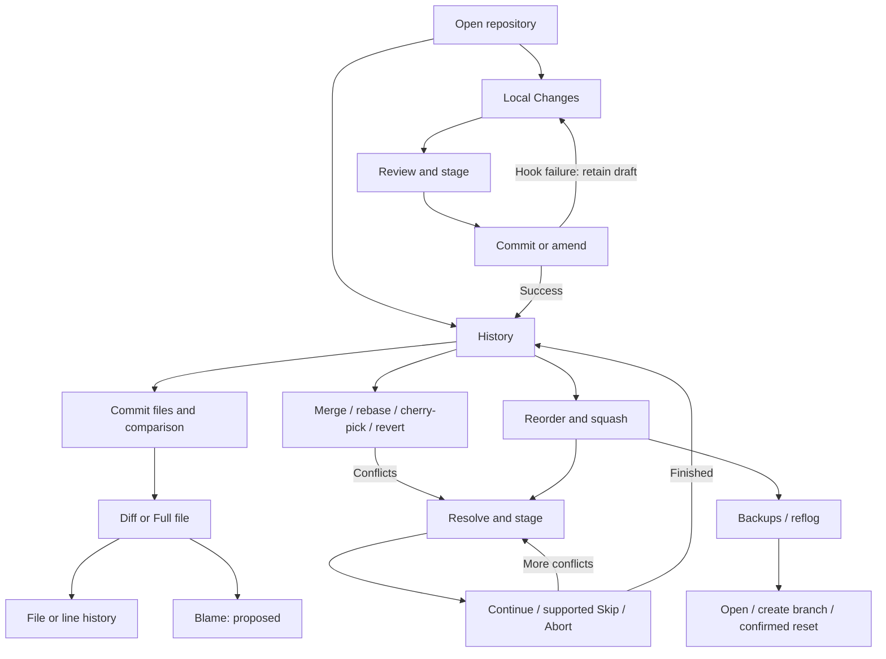

# User flows and UI mockups

Purpose: review gg's feature coverage and describe end-to-end desktop journeys, recovery states, and proposed M7 interfaces.

Design review dated 2026-10-25. This document describes interaction design; it does not mark proposals as shipped. Behavior remains owned by [architecture](architecture.md), delivery order by [plan](plan.md), and release gates by [roadmap](../ROADMAP.md). The [interactive mockups](ui-mockups.html) use fictional repository data and simulate actions locally; they never execute Git.

Follow-up design direction: [coherent interaction proposal](ui-coherence.md) and [shared-workspace prototype](ui-coherence.html). It consolidates these feature flows into shared navigation, a common file reader, scoped commands, and one operation area. Local Changes follows the user's requested layout: Unstaged files above Staged files on the left; selected changes on the right; commit/amend below the changes. The flows below remain the feature coverage baseline; proposed differences and their implementation implications are owned by the coherence proposal.

## Feature and roadmap review

| Area | Documented state | User outcome | Design coverage |
| --- | --- | --- | --- |
| M0–M1: history and review | Complete/baseline | Find a commit, select a parent, inspect text or binary changes | F01–F02; History and Review mockups |
| M2: Local Changes | Complete | Stage file/hunk/lines, discard deliberately, commit with hooks | F03–F04; Stage, Discard, and Hook failure mockups |
| M3: graph and refs | Complete | Navigate references, switch/create branches, compare with HEAD | F01, F05; History and Branch mockups |
| M4: network | Complete | Clone, fetch, push, set upstream, cancel and retry | F06; Network mockup |
| M5: integration and recovery | Complete | Stash, merge, cherry-pick, revert, resolve and recover | F07–F09; Integrate, Conflicts, and Stash mockups |
| M6: rewriting and recovery | Complete | Amend, rebase, reorder/squash, inspect reflog and backups | F04, F08, F10; Rewrite and Recovery mockups |
| M7: file reading and file history | Complete increments inside an unfinished milestone | Read a complete file and follow content versions and renames | F02, F11; Reading and File history mockups |
| M7: blame and line/range history | Complete | Explain a line's origin without losing the selected range | F12; Blame mockup |
| M7: image comparison | Planned; binary previews/export already exist | Compare dimensions and pixels across revisions | F13; Images mockup |
| M7: worktrees | Planned | Work on another branch with isolated drafts and selection | F14; Worktrees mockup |
| M7: submodules and LFS | Planned | Understand nested revisions and pointer/object availability | F15–F16; Submodule and LFS mockups |
| M7: signing | Planned | Distinguish signature validity, trust, and signing setup | F17; Signing mockup |

The roadmap now distinguishes the already-completed reading surface and file history from the remaining M7 work. Read M7 as partially delivered, not wholly future work. The plan provides the finer delivery sequence. M0–M6 completion is a documented claim, not a fresh implementation audit; platform acceptance and preview gates remain separate in [verification](verification.md#preview-acceptance-pending).

The existing product has a coherent center: history → review → reading, and Local Changes → stage → commit. Recovery is equally central: failed operations lead to explicit Git state and a next action. M7 should extend those surfaces rather than add a separate dashboard. The highest design risk is confusing three independent axes: **file**, **comparison side**, and **content version**. Keep each named in a stable header. The second risk is presenting proposed worktree/submodule/LFS/signing actions as ordinary refreshes; each needs an explicit target and mutation boundary.

## Shared screen and interaction model

Keep Repository, Refs, View, and Help in the toolbar; stash and recovery tools live under Repository. Keep Local Changes and History in one stable navigation strip at every width; at wide widths retain grouped refs at the left, and at narrow widths use the Refs toolbar menu. Place file actions and commit actions beside their selected identity. One operation area sits directly beneath navigation, hidden when idle; the fixed-height status line shows severity, summary, Details, and at most one recovery action.

Retain selected commit, file, side, reading position, and filters through back navigation where the owning contracts specify them. Keep normal/amend drafts separately per canonical worktree. A pending worker disables duplicate/incompatible writes while browsing stays available; rewrite configuration closes on submission and its progress stays in the operation area. Never publish an old file's result under a new file's label.

Keyboard paths mirror visible controls: arrows or j/k select; Enter/Right opens; Escape/Left returns one level; Alt+A opens Actions; H opens file history; B is planned for blame; brackets move changes; Alt+Up/Down moves files; Alt+Left/Right moves history versions. Editors retain their text keys. Keep focus visible, give disabled actions visible reasons, accompany color with text/symbols, and follow the design's 4.5:1 contrast requirement in both themes.

The mockup selector is review tooling outside the product shell. Each screen is an interaction wireframe, not a native screenshot or a promise of final widget styling. **Narrow layout** demonstrates reflow, not a mobile product. Only scenario controls and the displayed primary flow actions simulate transitions; static context is presented as text. All proposed screen labels below are design recommendations.

## Detailed flows

### F01 · Open, find, and inspect history

**Entry:** launch in a repository, use Repository → Open, or return through History. **Goal:** identify a change without mutating the repository.

1. Resolve the containing repository and show its path, current branch, refs, and streamed history. Retain stable row slots while more history arrives.
2. Filter history; select a matching commit by pointer or keyboard. Selection reveals bounded subject/identity metadata; open complete text separately with Copy.
3. Select a ref pill to inspect its commit. Switching is explicit through the sidebar context menu or the Refs menu's **Switch to branch** command; tags and remotes are read-only inspections.
4. Press Enter to open changed files in F02. Escape restores the original row and viewport. Actions → Compare with current HEAD names Before and After with resolved IDs and the requested HEAD ref.

**Alternatives:** empty history/filter results state why no rows appear; a read error keeps an actionable Details view. Detached HEAD is named as such; no branch is inferred. Narrow layouts retain Refs access. **Completion:** the chosen commit is selected, with no objects, refs, index, or worktree writes. **Mockup:** History → Review.

### F02 · Review a commit and read a file

**Entry:** Enter on a history commit. **Precondition:** a resolved commit, and a chosen one-based parent for merges.

1. Show subject, commit ID, parent selector, and persistent comparison direction. Root commits name the empty-tree base.
2. Choose a changed file. Keep the previous displayed file correctly labeled while a worker loads the new selection; replace identity, metadata, and rows together.
3. Open the full-width reader with Enter. Diff shows both sides; Full file reads the chosen Before/After side with exact line numbers and changed-line markers.
4. Use Prev/Next change or brackets, and Prev/Next file or Alt+Up/Down. File navigation keeps presentation/side and approximately preserves the line, clamped to the new file.
5. Switch Diff/Full file without losing path, side, or reading position. Escape returns to files, then history.

**Alternatives:** addition/deletion defaults to the side that exists; an absent side is explicit. Binary, symlink, gitlink, and reads beyond 2 MiB/100,000 lines have named summaries, not blank editors. Binary previews/hex and Export before/after remain available within existing bounds. Export selects a new destination and reports failures. **Completion:** a file and exact comparison are understood; reading is read-only. **Mockup:** Review → Reading → File history.

### F03 · Build a commit from selected changes

**Entry:** Local Changes. **Goal:** commit only intended index contents.

1. Scan and group staged, unstaged, untracked, and conflicted paths; keep scan completion distinct from a clean tree.
2. Select an entry in either counted group. It immediately selects that comparison in the shared reader: Staged is HEAD → index, Unstaged is index → working file, and amend is HEAD parent → index. There is no separate View diff step or Staged/Unstaged reader switch; the reader stays in place, and its header names the path, exact endpoints, and Diff/Full file once. Review uses Enter or double-click for its full-width reading layout.
3. Use File actions for a whole path, Stage hunk for one hunk, or select changed lines and Stage selected. Unstage and Discard mirror those scopes. The same reader keeps Diff/Full, Before/After, and the reading place; refresh both lists and the active comparison in place and preserve independent selections/scroll.
4. Return to files and enter a message. Enable Commit only when the validated scan is complete, the message is nonempty, and staged changes exist. Name any blocking conflict or unsupported index state.
5. Commit the index through hooks. On success clear only the submitted draft; History refreshes and selects the new commit.

**Alternatives:** partial staging is for supported regular text modifications; offer whole-file actions for other supported kinds rather than imply line staging works. A stale diff rejects without publishing and reloads; preserve the draft. A hook failure keeps index/worktree/message and exposes hook output through Details; refresh status because hooks may have staged edits. A post-commit hook failure states that the commit already exists. **Completion:** the new commit contains the reviewed index; unrelated working changes remain. **Mockup:** Stage → commit success or Hook failure → Stage.

### F04 · Amend or discard deliberately

**Amend entry:** Local Changes → Amend. Switch to the separate amend draft or HEAD message and display the affected hash/subject. Staged becomes **HEAD parent → index**, showing the amended commit's actual contents. Stage adds working changes; Unstage removes content from the amended commit while preserving working files. Allow message-only amend. Save a private backup before rewriting, preserve the author, run hooks including post-rewrite, then refresh. Backup failure aborts before publication. Turning Amend off restores the normal draft. Hook failure retains the amend draft.

**Discard entry:** Unstaged → Discard file/hunk/selected. Show the exact path and scope; explain that tracked working content is restored from the index, untracked files are removed, and the index is unchanged. Cancel preserves everything and returns focus to the invoking action. Confirm refreshes both lists and the active comparison in place. Refuse stale/unsupported/conflicted scopes with a reason; never broaden the requested scope. **Completion:** only the confirmed content changes. **Mockup:** Stage → Discard → Stage; amend is specified here rather than simulated.

### F05 · Switch, create, track, and delete references

**Entry:** Refs sidebar/menu or ref context menu.

1. Select a local branch and Switch, or use New branch with a name, starting point, and **Switch after creation**. Tracking a remote explicitly names both the new local branch and remote ref.
2. Validate the name, existence, target, and clean-worktree precondition before switching. A blocked switch names local changes, keeps the target as intent, and offers **Retry switch**; it never silently discards changes or re-queues the switch automatically. Retrying revalidates from the current state.
3. On success update HEAD check, graph, refs, and tracking together. Ref selection and branch switching remain distinct gestures.
4. Delete branch tries safe deletion first; an unmerged branch offers an explicitly confirmed force-delete path. Tag deletion confirms its exact target. A failed action leaves the selected ref and failure detail visible.

**Completion:** branch identity and checkout outcome are clear. Branch creation and switching are one form with one explicit switch choice; creating a recovery branch at a saved commit defaults to staying and does not switch. **Mockup:** Branch shows a dirty-worktree block and route to Stage.

### F06 · Clone, fetch, and push

**Clone:** Repository → Clone → URL and destination → validate → bounded progress/Cancel → open the repository only after success. An existing nonempty destination or authentication failure remains actionable; retain inputs and never clean up user files automatically.

**Fetch:** select the explicit configured remote (or documented sole/default choice), optionally prune, then start. Fetch updates remote-tracking refs; it does not merge or change working files. Success refreshes history/refs while retaining selection. Cancel/failure preserves the previous display and offers Retry fetch.

**Push:** show local branch, destination remote/branch, and upstream decision when missing. Start a non-force push; report progress and allow cancellation. A rejected push offers Details and Retry push; guide the user to fetch and inspect before integration, without automatic fetch, merge, rebase, or force push. Record upstream only after successful push. Credentials use Git configuration/helpers/SSH; output excludes secrets.

**Completion:** a receipt names the actual outcome; tracking refreshes when changed. **Mockup:** Network toggles rejected/pending/success states; Retry push is a simulation.

### F07 · Park and restore work with stash

**Entry:** Repository → Stash changes or Stashes.

1. Enter a message; explicitly choose Include untracked and Keep index. A clean worktree reports no changes to stash.
2. Create the stash on the serialized worker and refresh status. The Stashes window shows the exact stash ref, commit, and message.
3. Select **Restore…**, then choose **Restore staged state** and/or **Remove stash after successful restore**. Remove maps to pop only after a conflict-free apply.
4. On conflict retain the entry and report unmerged paths in the shared conflict workspace. A stash conflict is not a sequencer operation: do not invent Continue/Skip/Abort buttons for it.
5. Drop confirms the exact stash and leaves working files untouched.

**Completion:** restored work or a preserved recovery entry is visible. **Mockup:** Stash → conflict state, with the retained entry named.

### F08 · Integrate a branch or selected commit

**Entry:** Refs → Merge/Rebase, or selected commit → Cherry-pick/Revert.

1. Name current branch, target ref/commit, and direction: merge target **into** current; rebase current **onto** target; cherry-pick applies selected change; revert creates its inverse.
2. Merge offers Always create a merge commit; rebase explicitly offers Automatically stash working changes and warns about rewritten IDs/private backup. Require clean tracked worktree unless the specific operation permits chosen autostash.
3. Submit once. Merge/rebase dialogs close immediately, the operation area names the pending phase, and incompatible writes disable while browsing remains usable.
4. Success reports fast-forward, already-up-to-date, merge commit, or rewritten tip as appropriate. Refresh relevant views once. Conflict enters F09; failure retains Git's recoverable state and Details.

**Completion:** the user sees the operation's outcome and updated branch. **Mockup:** Integrate → Conflicts is a deliberately conflicted merge example. Rebase follows the same recovery shell with operation-aware labels.

### F09 · Resolve conflicts and finish or abort

**Entry:** operation area → Resolve conflicts. **Precondition:** actual unmerged paths, or an externally detected operation on launch.

1. Name operation, unresolved count, and operation commit. Select an unresolved path; load Base/Ours/Theirs on workers.
2. Explain side identities for that operation. For rebase, Ours is the rebased destination/current replay state and Theirs the commit being replayed; never equate Ours with 'my branch' universally.
3. Choose Base, Ours, Theirs, or the working file to change only the Result preview. Edit externally and use Refresh external edits to preview it. **Stage resolution** is the single publication step; it validates the original stages and working bytes and stages the previewed result. State those consequences next to the controls. Select the next unresolved path after success.
4. Keep Continue disabled until unresolved paths reach zero; then run it on the operation worker. A later conflict returns to this flow.
5. Abort requests Git's recovery and refreshes; report any failure rather than promise removal of all user edits. Skip exists only for supporting operations (rebase/cherry-pick/revert), never merge. Narrow layouts show side tabs with bounded content.

**Alternatives:** absent sides/deletion, binary files, stale reads, external changes, and worker failure require explicit states; keep the operation area until Git says it ended. **Completion:** operation completes or aborts, refs/history/status/reflog/backups refresh, and prior selection/Local Changes context returns. **Mockup:** Conflicts → resolved → Continue; merge has no Skip.

### F10 · Rewrite and recover a previous tip

**Entry:** selected history commit → Reorder and squash to HEAD.

1. Resolve the inclusive linear range oldest first; reject merge ranges. Show every commit exactly once, Up/Down, and Pick/Squash. The first row always remains Pick.
2. Review the plan, clean-worktree/autostash choice, and private-backup notice; confirm the rewrite.
3. Close the plan on submission. The operation area shows Rewriting commits, then Refreshing history until the replacement history is accepted; browsing stays available and the old history remains labeled. Conflicts use F09.
4. From Repository → Recovery choose Backups or Reflog, then inspect the source, kind, subject, and commit time. **Open commit** verifies content in the ordinary reader; Back returns to that source, the Reflog reference filter, and the selected entry.
5. **Create branch here…** opens the shared branch form with **Switch after creation** off. Reset branch here offers Soft (move tip), Mixed (also reset index), or Hard (also discard staged/working changes), with exact-target confirmation and Hard warning. Copy hash/ref is read-only. Keep backups after recovery.

**Completion:** rewritten history or a recovered tip is reachable and selection restores. **Mockup:** Rewrite → Recovery; primary Create branch here demonstrates the nondestructive route.

### F11 · Follow a file through content versions

**Entry:** Reading → History/H. **Goal:** understand how the selected file evolved without moving history selection or HEAD.

1. Change the comparison source inside the shared reader while keeping the file list and entry context in place. Show a version strip with version change kind, hash, subject, author, date, and old path for renames.
2. Older version moves one older content version and Newer version one newer. Skip unchanged commits. Keep version navigation separate from Before/After inspection sides; Full file shows current content, Diff shows previous → current.
3. Follow a unique predecessor silently. For multiple genuinely ambiguous predecessors, show candidates with kind/hash/subject/author/date/old path and require a choice; until then current Full file remains available and Diff disables.
4. Page earlier versions on demand. Distinguish Loading earlier versions, trace limit, failed page with retry, Oldest version, Newest version, and Only version; never wrap.
5. A deletion is an absent version, not empty content; a re-add begins an added edge. Escape returns to the exact reading context, then the file list.

**Completion:** a version/edge is selected without repository mutation. **Mockup:** File history includes version navigation and a predecessor-choice scenario.

### F12 · Attribute and trace a line or range · M7

**Entry:** line/range selection in Reading → **Show attribution** or `B`, then **Line history**. Attribution on either committed side, line/range mapping, **Open commit**, and deleted-line Before anchoring are implemented. **Contract:** anchor exact path bytes, revision, and inclusive lines; map single lines through blame and ranges through diff hunks.

1. Show attribution beside source lines: origin commit, author, and date; selecting a line shows its complete metadata and Open commit/Line history actions. Keep the selected place visible when toggling attribution.
2. Line history opens the same version timeline anchored to the place. Follow renames and remap line numbers; name both the current path/range and old path when changed.
3. A deleted range explicitly anchors Before. If the range spans divergent hunks, ask which predecessor to follow and show candidate ranges; do not silently shrink the selection or invent a common boundary.
4. Back returns through timeline → blame → reader with selection restored. A cancelled/stale worker result never replaces a newer place.

**Proposed states:** loading attribution, unavailable/shallow history, unsupported binary, and failed lookup retain source and exact place with Details/Retry. **Completion:** origin or an honest boundary is visible. **Mockup:** Blame → File history; the full range chooser is specified here, not simulated. No uncommitted-line blame semantics are assumed.

### F13 · Compare images · proposed M7

**Entry:** choose a supported image in commit review. Existing previews/export stay available.

1. Show Before/After IDs, dimensions, and byte sizes; use explicit Absent for additions/deletions.
2. Choose Side by side or Swipe; a labeled slider controls the boundary, including by keyboard. Pair Fit/Actual size with visible zoom context; preserve side identity when changing presentation.
3. Different dimensions stay visible; do not stretch one image to pretend the sizes match. Transparency needs a neutral checkerboard. Export before/after uses the original complete content and new-file rules.

**Proposed states:** unsupported format/decoding failure/preview budget show metadata and export rather than an empty canvas. Narrow layouts stack named before/after previews; swipe remains optional. **Completion:** user understands visual change and size. **Mockup:** Images demonstrates side-by-side/stacked previews; swipe/zoom are design requirements only.

### F14 · Manage isolated worktrees · proposed M7

**Entry proposal:** Repository → Worktrees. List canonical path, branch/detached state, current/other worktree, dirty state, and availability.

1. Create: choose destination and existing or new branch; validate an empty destination and branch availability. Name a branch checked out elsewhere and link to opening that worktree instead of offering a silent force.
2. Submit once, show progress, and add the worktree only after success. Open switches context after retaining the current worktree's drafts, selected commit/file, filters, and reading place.
3. Returning restores the original worktree's state; a new worktree starts with separate drafts.
4. Remove identifies exact path/branch and rechecks dirty state. Proposed default blocks dirty removal and offers Open to inspect. Confirm clean removal; do not add a force/delete-user-files route in this design. Main/locked/unavailable worktrees show explicit restrictions and actionable details.

**Completion:** the correct worktree is active or removed without state leakage. **Mockup:** Worktrees → Open with a visible draft-isolation receipt. **Decision before implementation:** removal/unregistration behavior for missing paths and locked worktrees needs an owning architecture contract.

### F15 · Inspect and update a submodule · proposed M7

**Entry proposal:** select a gitlink in Review or Local Changes → Submodule details.

1. Show parent-recorded commit, checked-out submodule commit, initialization/dirty state, and exact path; historical review names Before/After recorded commits.
2. Open nested repository for inspection as its own context. Browsing never initializes, checks out, or stages a submodule automatically.
3. Update explicitly states destination commit and whether network is needed. Validate nested changes, confirm, run progress, then rescan nested and parent states.
4. Keep parent-index staging a separate deliberate action; a nested checkout is not itself a parent commit.

**Proposed states:** uninitialized, dirty, missing recorded object, offline/failure, and changed URL/configuration each retain target identity and Details. Block dirty overwrite. **Completion:** actual nested state and parent reference remain distinguishable. **Mockup:** Submodule shows a blocked dirty update. **Decision:** initialization/network policy and CLI parity need specification before implementation.

### F16 · Inspect an LFS pointer and retrieve content · proposed M7

**Entry proposal:** select an LFS-managed file in Review or Local Changes.

1. Identify Pointer and show full SHA-256 object identity, declared size, and local-object availability separately from Git blob identity.
2. If content is unavailable, retain the pointer view and offer explicit Fetch object with named remote and download size; do not fetch on selection or refresh.
3. Run cancellable progress; after success mark content available and offer bounded preview where supported. Any working-file smudge/materialization must be a distinct explicit action with its own target/preconditions.

**Proposed states:** LFS executable/configuration missing, offline/auth failure, malformed pointer, oversized preview, and cancellation keep the pointer and next action. Never label pointer text as the fetched image. **Completion:** availability is accurate without hidden network or worktree writes. **Mockup:** LFS → Fetch object → locally available. **Decision:** object retrieval and materialization API/CLI semantics remain open.

### F17 · Verify signatures and sign deliberately · proposed M7

**Entry proposal:** commit details/tag details → Signature details; Local Changes → signing choice only after configuration is explicit.

1. Show signed object identity, signature format, signer/key identifier, verification result, and trust result separately. Unsigned, invalid, unknown key, untrusted valid signature, and tool unavailable are distinct states.
2. Opening verification never modifies trust stores or repository signing configuration. Errors include readable Details and Retry where meaningful.
3. Signing setup names repository scope, format, and identity. A proposed commit-signing action summarizes that choice before hooks/signing; missing key/agent failure retains the draft and index without silently falling back to unsigned.
4. Signed tag creation needs its own explicit name, target, message, and signing identity; merely verifying a tag does not create one.

**Completion:** verification means what it says, or a deliberate signing attempt reports its outcome. **Mockup:** Signing distinguishes validity from trust; signing setup/tag creation are specified proposals only. **Decision:** supported formats, trust interpretation, configuration ownership, and CLI signing flags need architecture and acceptance contracts before implementation.

## Review and delivery sequence

Keep the plan's sequence: blame/line history → image diffs → worktrees → submodules → LFS → signing. Finish the blame place-mapping and divergent-range chooser first; reuse the shipped history cursor rather than creating a second timeline. For each remaining increment, settle the decisions called out above, define shared engine/CLI behavior, then implement native UI and verification together. No date or new milestone commitment is inferred.

| Review scenario | Expected observation |
| --- | --- |
| Keyboard-only inspect → history → back | Focus and original file/place restore; editors retain text navigation |
| Rapid file/side/version changes | Old results never appear under the new identity |
| Normal and amend drafts; worktree switch | Drafts stay separate, hook failure retains them, success clears submitted text only |
| Partial staging followed by discard | Index and working scopes stay explicit; discard confirmation names unchanged index |
| Rejected push or stash apply conflict | Details and one relevant recovery action; stash entry remains |
| Merge versus rebase conflict | Correct side identities; Continue gated; merge has no Skip |
| Rewrite success/conflict/backup failure | Progress through accepted refresh; recoverable prior tip; no publication after backup failure |
| Rename, deletion, merge ambiguity, history limit | Honest path/side/version identity; explicit chooser and boundaries |
| Image dimensions, unavailable LFS, unknown signing key | No misleading empty preview, hidden fetch, or inferred trust |
| Wide/narrow, light/dark, long Unicode paths, display scaling | Reachable controls, readable diffs, bounded metadata, visible focus |

These are future implementation acceptance scenarios, not test results for this design pack. The mockups cover representative states and local transitions; they do not validate native widgets, Git behavior, performance, platform support, or assistive technology. Record that evidence in [verification](verification.md) when features are implemented.

## Mockup sources

Open [ui-mockups.html](ui-mockups.html) in a browser. The editable source is [ui-mockups.fragment.html](ui-mockups.fragment.html); the standalone file wraps it with the visualization runtime's styles and sandbox. Keep both in sync when editing. The pack has 20 screens covering F01–F17, including disabled, failed, conflicted, loading, and recovery examples. Scenario controls are review-only and never execute Git. No production Rust code changes are required for this review.

Browser review and example captures: [design-pack verification](verification.md#user-flow-design-pack--2026-10-25).
